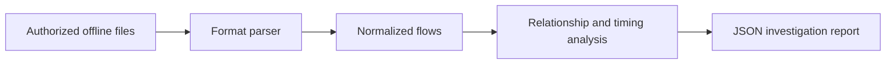

# Architecture and threat model

The CLI receives explicit local files. It parses them in bounded mode, normalizes `Flow` records, aggregates directed source/destination relationships, calculates threshold evidence, and emits one JSON report. A report retains the SHA-256 of input bytes and source references; original evidence files are never changed. For multiple NetFlow datagrams, the hash covers their bytes in CLI order. The decoder caches templates per protocol version, declared exporter, observation domain, and template ID.

The trust boundary is imported capture/log data. Parsing is read-only, files are capped at 512 MiB, PCAP records at one million and 262,144 bytes each, Zeek records at one million and 262,144 bytes each, and NetFlow datagrams at 65,535 bytes. Unknown templates, unsupported fields, invalid timestamps, and malformed records produce issues or explicit errors. Live network collection is absent. There is no API, credential, database, or frontend in this milestone; those are future components rather than placeholders.

Threats include malformed lengths causing over-read, template poisoning across exporters, huge files causing memory exhaustion, and mislabeling benign periodic jobs as malicious beaconing. The current parser bounds lengths and scopes templates; interpretation text explicitly limits conclusions. Remaining risks include aggregate memory use on very large accepted captures and incomplete protocol coverage. Use an isolated, resource-limited host for hostile captures.
